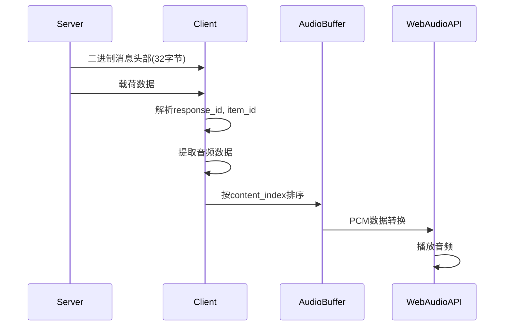

# 音频二进制协议格式文档

## 概述

本文档描述了实时语音对话系统中音频二进制数据的传输格式，帮助TypeScript客户端正确解析和播放接收到的音频数据。

## 二进制消息结构

### 1. 消息头部 (32字节)

```typescript
interface BinaryHeader {
    session_id: string;     // 16字节 - nanoid会话标识
    protocol_id: number;    // 1字节 - 协议ID (TTS = 3, All = 100)
    command_id: number;     // 1字节 - 命令ID (ResponseAudioDelta = 20)
    reserved: Uint8Array;   // 14字节 - 预留字段
}
```

### 2. 响应音频增量消息 (CommandId = 20)

#### 载荷格式
```
[response_id_len(4bytes)] + [response_id_utf8] + [item_id_len(4bytes)] + [item_id_utf8] + [output_index(4bytes)] + [content_index(4bytes)] + [audio_data]
```

#### 字段说明
- `response_id_len`: response_id字符串长度（小端序4字节）
- `response_id_utf8`: response_id的UTF-8字节序列
- `item_id_len`: item_id字符串长度（小端序4字节）
- `item_id_utf8`: item_id的UTF-8字节序列
- `output_index`: 输出索引（小端序4字节）
- `content_index`: 内容索引（小端序4字节）
- `audio_data`: 实际音频数据

## 音频数据格式

### PCM格式参数
- **采样率**: 16000 Hz
- **声道**: 单声道 (mono)
- **位深度**: 16位
- **字节序**: 小端序 (little-endian)
- **数据类型**: 有符号整数 (-32768 到 32767)

### 时间片配置
- **默认时间片**: 20ms
- **每帧样本数**: 16000 * 0.02 = 320样本
- **每帧字节数**: 320 * 2 = 640字节

## 消息流程图



## TypeScript实现要点

### 1. 二进制解析器
```typescript
class BinaryMessageParser {
    parseResponseAudioDelta(data: ArrayBuffer): AudioChunk {
        // 解析头部
        const header = this.parseHeader(data.slice(0, 32));

        // 解析载荷
        const payload = new DataView(data.slice(32));
        let offset = 0;

        // 读取response_id
        const responseIdLen = payload.getUint32(offset, true);
        offset += 4;
        const responseId = this.readString(payload, offset, responseIdLen);
        offset += responseIdLen;

        // 读取item_id
        const itemIdLen = payload.getUint32(offset, true);
        offset += 4;
        const itemId = this.readString(payload, offset, itemIdLen);
        offset += itemIdLen;

        // 读取索引
        const outputIndex = payload.getUint32(offset, true);
        offset += 4;
        const contentIndex = payload.getUint32(offset, true);
        offset += 4;

        // 读取音频数据
        const audioData = new Uint8Array(data.slice(32 + offset));

        return {
            responseId,
            itemId,
            outputIndex,
            contentIndex,
            audioData
        };
    }
}
```

### 2. 音频缓冲管理
```typescript
class AudioBufferManager {
    private buffers: Map<string, Map<number, ArrayBuffer>> = new Map();

    addChunk(chunk: AudioChunk) {
        if (!this.buffers.has(chunk.responseId)) {
            this.buffers.set(chunk.responseId, new Map());
        }

        const responseBuffers = this.buffers.get(chunk.responseId)!;
        responseBuffers.set(chunk.contentIndex, chunk.audioData);

        // 检查是否可以播放连续的音频块
        this.tryPlaySequence(chunk.responseId);
    }
}
```

### 3. Web Audio API集成
```typescript
class WebAudioPlayer {
    private audioContext: AudioContext;
    private sampleRate: number = 16000;

    constructor() {
        this.audioContext = new AudioContext({
            sampleRate: this.sampleRate
        });
    }

    playPCMData(pcmData: ArrayBuffer) {
        // 转换16位PCM到Float32
        const float32Data = this.convertPCMToFloat32(pcmData);

        // 创建AudioBuffer
        const audioBuffer = this.audioContext.createBuffer(
            1, // 单声道
            float32Data.length,
            this.sampleRate
        );

        // 填充数据
        audioBuffer.getChannelData(0).set(float32Data);

        // 播放
        const source = this.audioContext.createBufferSource();
        source.buffer = audioBuffer;
        source.connect(this.audioContext.destination);
        source.start();
    }

    private convertPCMToFloat32(pcmData: ArrayBuffer): Float32Array {
        const view = new Int16Array(pcmData);
        const float32Data = new Float32Array(view.length);

        for (let i = 0; i < view.length; i++) {
            float32Data[i] = view[i] / 32768.0;
        }

        return float32Data;
    }
}
```

## 低延迟优化策略

### 1. 缓冲区管理
- **最小缓冲区**: 保持2-3个音频块（40-60ms）
- **动态调整**: 根据网络状况调整缓冲区大小
- **预加载**: 在播放前预加载第一个音频块

### 2. 播放调度
- **精确计时**: 使用AudioContext.currentTime进行精确调度
- **无缝拼接**: 确保音频块之间无缝连接
- **延迟补偿**: 补偿网络和处理延迟

### 3. 错误处理
- **丢包处理**: 检测缺失的content_index
- **重连机制**: WebSocket断线自动重连
- **降级策略**: 高延迟时切换到更大的缓冲区

## 事件处理

### 相关WebSocket事件
- `response.audio.delta`: 音频增量数据
- `response.audio.done`: 音频数据完成
- `output_audio_buffer.started`: 开始播放
- `output_audio_buffer.stopped`: 停止播放
- `output_audio_buffer.cleared`: 缓冲区清空

### 处理流程
1. 收到`response.audio.delta`二进制消息
2. 解析并按content_index排序
3. 转换PCM数据为Float32
4. 调度到Web Audio API播放
5. 处理`response.audio.done`完成信号

## 调试建议

### 1. 日志记录
- 记录每个音频块的接收时间
- 监控缓冲区状态
- 跟踪播放延迟

### 2. 性能监控
- 测量解析时间
- 监控内存使用
- 检测音频中断

### 3. 测试用例
- 模拟网络延迟
- 测试丢包场景
- 验证音频质量

## 常见问题

### Q: 音频播放有卡顿？
A: 检查缓冲区大小，适当增加预加载量，确保音频块按顺序播放。

### Q: 音频质量差？
A: 确认PCM参数正确（16位、16kHz、单声道），检查字节序转换。

### Q: 延迟过高？
A: 减少缓冲区大小，优化播放调度，使用更小的音频时间片。

### Q: 音频断裂？
A: 检查content_index连续性，处理缺失的音频块，确保无缝拼接。
