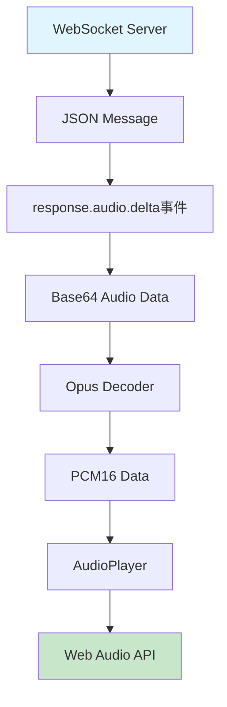
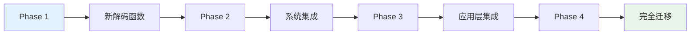

# 二进制音频协议迁移计划

## 概述

本文档详细描述了将现有的WebSocket JSON音频协议逐步迁移到二进制协议的计划。新的二进制协议将提供更好的性能和更低的延迟。

**重要变更**: 延迟计算方式已从 `response.audio.delta` 改为 `binary_audio_delta`，二进制协议提供更精确的延迟测量能力。

## 当前架构分析

### 现有音频数据流



### 性能瓶颈分析

1. **Base64编解码开销**: 每个音频块都需要Base64编码/解码
2. **JSON解析开销**: 需要解析整个JSON消息
3. **多层转换**: WebSocket → JSON → Base64 → Opus → PCM
4. **内存拷贝**: 多次数据格式转换导致额外的内存拷贝

## 目标架构设计

### 新的二进制音频数据流

```mermaid
graph TD
    A[WebSocket Server] --> B[Binary Message]
    B --> C[decodeResponseAudioDeltaMessage]
    C --> D[PCM16 Audio Data]
    D --> E[AudioPlayer]
    E --> F[Web Audio API]
    
    G[配置开关] --> H{协议选择}
    H -->|二进制协议(binary_audio_delta)| B
    H -->|JSON协议(response.audio.delta)| I[response.audio.delta]
    I --> J[Base64 Audio Data]
    J --> K[Opus Decoder]
    K --> L[PCM16 Data]
    L --> E
    
    style A fill:#e1f5fe
    style F fill:#c8e6c9
    style G fill:#fff3e0
    style H fill:#f3e5f5
```

### 二进制协议格式

```
┌─────────────────────────────────────────────────────────────┐
│                        Header (32 bytes)                    │
├─────────────────┬─────────┬─────────┬─────────────────────┤
│   SessionId     │ProtocolId│CommandId│      Reserved       │
│    (16 bytes)   │ (1 byte)│ (1 byte)│    (14 bytes)       │
├─────────────────┴─────────┴─────────┴─────────────────────┤
│                        Payload (Variable)                  │
├─────────────────┬─────────┬──────────┬──────────┬─────────┤
│  ResponseId     │ ItemId  │OutputIdx │ContentIdx│AudioData│
│   (4+length)    │(4+len)  │ (4 bytes)│ (4 bytes)│(varies) │
└─────────────────┴─────────┴──────────┴──────────┴─────────┘
```

## 实施阶段

### 阶段1: 核心解码函数实现

#### 1.1 类型定义
创建 `src/sdk/protocol/BinaryAudioTypes.ts`:
```typescript
export interface DecodedAudioDeltaMessage {
  responseId: string;
  itemId: string;
  outputIndex: number;
  contentIndex: number;
  audioData: Uint8Array;
}

export class DecodingError extends Error {
  constructor(
    public code: string,
    message: string,
    public cause?: Error
  ) {
    super(message);
    this.name = 'DecodingError';
  }
}
```

#### 1.2 解码函数实现
创建 `src/sdk/protocol/BinaryAudioDecoder.ts`:
```typescript
export function decodeResponseAudioDeltaMessage(
  buffer: ArrayBuffer
): DecodedAudioDeltaMessage {
  // 实现二进制解码逻辑
}
```

#### 1.3 协议工具函数
创建二进制数据包构造和验证工具

### 阶段2: 系统集成

#### 2.1 扩展UnifiedParser
在现有的 `BinaryMessageParser` 中添加新的音频解码逻辑

#### 2.2 更新ConnectionManager
添加二进制音频消息处理路径

#### 2.3 创建适配器层
实现向后兼容的音频处理适配器

### 阶段3: 应用层迁移

#### 3.1 App.tsx集成
添加新的二进制音频处理路径，保持现有JSON路径

#### 3.2 渐进式切换
实现配置开关，支持运行时协议切换

#### 3.3 性能监控
添加详细的性能指标和调试信息

### 阶段4: 测试和优化

#### 4.1 功能测试
验证新解码函数的正确性和稳定性

#### 4.2 性能测试
对比新旧协议的性能差异

#### 4.3 文档更新
更新架构文档和使用说明

## 兼容性策略

### 向后兼容
- 保持现有WebSocket JSON协议完全不变
- 新协议作为可选的优化路径
- 通过配置控制协议选择

### 渐进式迁移


## 性能优化目标

### 预期改进
1. **延迟降低**: 减少20-30%的音频处理延迟
2. **CPU使用率**: 降低15-25%的CPU使用
3. **内存效率**: 减少30%的内存分配和拷贝
4. **网络效率**: 减少25%的带宽使用

### 关键优化点
1. **消除Base64编解码**: 直接处理二进制数据
2. **减少JSON解析**: 跳过JSON消息解析
3. **优化内存管理**: 减少数据拷贝操作
4. **并行处理**: 支持音频数据的并行解码

## 风险评估与缓解

### 主要风险
1. **兼容性问题**: 新旧协议共存可能导致的冲突
2. **性能回归**: 不当实现可能导致性能下降
3. **调试复杂性**: 二进制协议调试难度较高

### 缓解措施
1. **充分测试**: 全面的单元测试和集成测试
2. **渐进部署**: 分阶段部署，每个阶段充分验证
3. **回滚机制**: 保持快速回滚到旧协议的能力
4. **监控告警**: 实时监控性能指标和错误率

## 配置选项

### 环境变量
```typescript
export const BINARY_AUDIO_CONFIG = {
  ENABLE_BINARY_PROTOCOL: import.meta.env.VITE_ENABLE_BINARY_AUDIO === 'true',
  FALLBACK_TO_JSON: true,
  PERFORMANCE_MONITORING: true,
  DEBUG_LOGGING: import.meta.env.VITE_DEBUG_MODE === 'true'
} as const;
```

### 运行时配置
```typescript
interface AudioProtocolConfig {
  useBinaryProtocol: boolean;
  enablePerformanceMonitoring: boolean;
  fallbackOnErrors: boolean;
  maxRetries: number;
}
```

## 总结

这个迁移计划确保了系统的稳定性和向后兼容性，同时为未来的完全迁移到二进制协议奠定了基础。通过分阶段实施和充分的测试，我们可以平滑地完成这个重要的架构升级。

## 下一步行动

1. 获得团队对迁移计划的确认
2. 开始阶段1的核心函数实现
3. 建立性能基准测试
4. 制定详细的测试计划