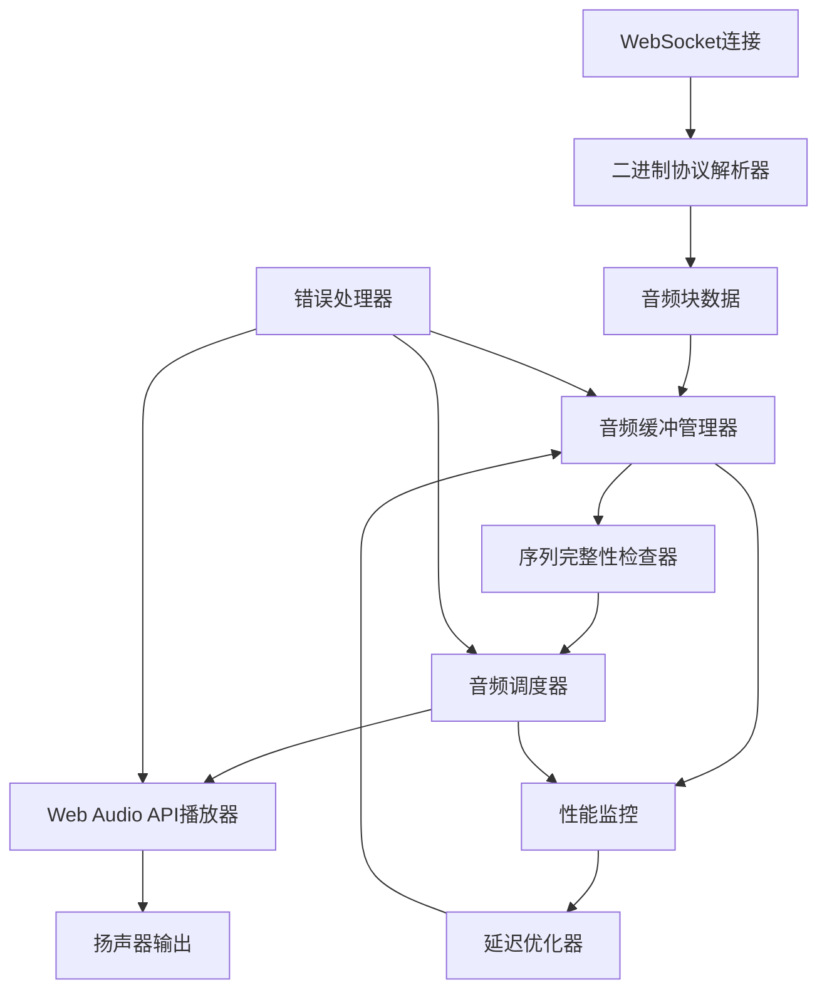

# TypeScript客户端音频处理架构设计

## 整体架构概览



## 核心模块设计

### 1. 二进制协议解析器 (BinaryProtocolParser)

**职责**: 解析服务器发送的二进制音频消息

```typescript
interface AudioChunk {
    responseId: string;
    itemId: string;
    outputIndex: number;
    contentIndex: number;
    audioData: ArrayBuffer;
    timestamp: number;
}

class BinaryProtocolParser {
    private readonly HEADER_SIZE = 32;
    private readonly COMMAND_RESPONSE_AUDIO_DELTA = 20;

    parseMessage(data: ArrayBuffer): AudioChunk | null {
        try {
            // 解析头部
            const headerView = new DataView(data, 0, this.HEADER_SIZE);
            const commandId = headerView.getUint8(17); // offset 17

            if (commandId !== this.COMMAND_RESPONSE_AUDIO_DELTA) {
                return null;
            }

            // 解析载荷
            return this.parseAudioDelta(data.slice(this.HEADER_SIZE));
        } catch (error) {
            console.error('解析二进制消息失败:', error);
            return null;
        }
    }

    private parseAudioDelta(payload: ArrayBuffer): AudioChunk {
        const view = new DataView(payload);
        let offset = 0;

        // 读取response_id
        const responseIdLen = view.getUint32(offset, true);
        offset += 4;
        const responseId = this.readString(view, offset, responseIdLen);
        offset += responseIdLen;

        // 读取item_id
        const itemIdLen = view.getUint32(offset, true);
        offset += 4;
        const itemId = this.readString(view, offset, itemIdLen);
        offset += itemIdLen;

        // 读取索引
        const outputIndex = view.getUint32(offset, true);
        offset += 4;
        const contentIndex = view.getUint32(offset, true);
        offset += 4;

        // 读取音频数据
        const audioData = payload.slice(offset);

        return {
            responseId,
            itemId,
            outputIndex,
            contentIndex,
            audioData,
            timestamp: Date.now()
        };
    }

    private readString(view: DataView, offset: number, length: number): string {
        const bytes = new Uint8Array(view.buffer, view.byteOffset + offset, length);
        return new TextDecoder().decode(bytes);
    }
}
```

### 2. 音频缓冲管理器 (AudioBufferManager)

**职责**: 管理音频块的缓冲、排序和组装

```typescript
interface AudioSequence {
    responseId: string;
    chunks: Map<number, AudioChunk>;
    expectedNextIndex: number;
    lastPlayedIndex: number;
    isComplete: boolean;
}

class AudioBufferManager {
    private sequences: Map<string, AudioSequence> = new Map();
    private maxBufferSize: number = 10; // 最多缓存10个音频块
    private timeoutMs: number = 5000; // 5秒超时

    addChunk(chunk: AudioChunk): boolean {
        let sequence = this.sequences.get(chunk.responseId);

        if (!sequence) {
            sequence = {
                responseId: chunk.responseId,
                chunks: new Map(),
                expectedNextIndex: 0,
                lastPlayedIndex: -1,
                isComplete: false
            };
            this.sequences.set(chunk.responseId, sequence);
        }

        // 检查缓冲区大小
        if (sequence.chunks.size >= this.maxBufferSize) {
            console.warn(`音频缓冲区已满: ${chunk.responseId}`);
            return false;
        }

        sequence.chunks.set(chunk.contentIndex, chunk);

        // 检查是否有可播放的连续序列
        return this.checkPlayableSequence(sequence);
    }

    private checkPlayableSequence(sequence: AudioSequence): boolean {
        let playableChunks: AudioChunk[] = [];

        // 从expectedNextIndex开始查找连续的音频块
        for (let i = sequence.expectedNextIndex; ; i++) {
            const chunk = sequence.chunks.get(i);
            if (!chunk) {
                break;
            }
            playableChunks.push(chunk);
        }

        if (playableChunks.length > 0) {
            // 更新期望的下一个索引
            sequence.expectedNextIndex += playableChunks.length;

            // 触发播放事件
            this.onPlayableChunksReady(sequence.responseId, playableChunks);
            return true;
        }

        return false;
    }

    private onPlayableChunksReady(responseId: string, chunks: AudioChunk[]) {
        // 发送到音频调度器
        audioScheduler.scheduleChunks(responseId, chunks);
    }

    markSequenceComplete(responseId: string) {
        const sequence = this.sequences.get(responseId);
        if (sequence) {
            sequence.isComplete = true;
        }
    }

    clearSequence(responseId: string) {
        this.sequences.delete(responseId);
    }

    // 清理超时的序列
    cleanup() {
        const now = Date.now();
        for (const [responseId, sequence] of this.sequences) {
            if (now - sequence.chunks.get(0)?.timestamp > this.timeoutMs) {
                this.sequences.delete(responseId);
            }
        }
    }
}
```

### 3. 音频调度器 (AudioScheduler)

**职责**: 精确调度音频播放，确保低延迟和无缝播放

```typescript
interface ScheduledChunk {
    audioBuffer: AudioBuffer;
    startTime: number;
    responseId: string;
}

class AudioScheduler {
    private audioContext: AudioContext;
    private sampleRate: number = 16000;
    private targetLatency: number = 0.02; // 20ms目标延迟
    private scheduledChunks: ScheduledChunk[] = [];

    constructor() {
        this.audioContext = new AudioContext({ sampleRate: this.sampleRate });
    }

    async scheduleChunks(responseId: string, chunks: AudioChunk[]) {
        for (const chunk of chunks) {
            try {
                const audioBuffer = await this.convertToAudioBuffer(chunk.audioData);
                const startTime = this.calculateStartTime();

                const scheduledChunk: ScheduledChunk = {
                    audioBuffer,
                    startTime,
                    responseId
                };

                this.scheduledChunks.push(scheduledChunk);
                this.playChunk(scheduledChunk);

            } catch (error) {
                console.error('音频调度失败:', error);
            }
        }
    }

    private async convertToAudioBuffer(pcmData: ArrayBuffer): Promise<AudioBuffer> {
        // 转换16位PCM到Float32
        const int16View = new Int16Array(pcmData);
        const float32Data = new Float32Array(int16View.length);

        for (let i = 0; i < int16View.length; i++) {
            float32Data[i] = int16View[i] / 32768.0;
        }

        // 创建AudioBuffer
        const audioBuffer = this.audioContext.createBuffer(
            1, // 单声道
            float32Data.length,
            this.sampleRate
        );

        audioBuffer.getChannelData(0).set(float32Data);
        return audioBuffer;
    }

    private calculateStartTime(): number {
        const now = this.audioContext.currentTime;

        if (this.scheduledChunks.length === 0) {
            // 第一个音频块，立即播放
            return now;
        }

        // 计算上一个音频块的结束时间
        const lastChunk = this.scheduledChunks[this.scheduledChunks.length - 1];
        const lastDuration = lastChunk.audioBuffer.duration;
        const lastEndTime = lastChunk.startTime + lastDuration;

        // 确保无缝连接
        return Math.max(now, lastEndTime);
    }

    private playChunk(scheduledChunk: ScheduledChunk) {
        const source = this.audioContext.createBufferSource();
        source.buffer = scheduledChunk.audioBuffer;
        source.connect(this.audioContext.destination);

        source.onended = () => {
            this.onChunkPlayed(scheduledChunk);
        };

        source.start(scheduledChunk.startTime);

        console.log(`调度音频播放: ${scheduledChunk.responseId}, 开始时间: ${scheduledChunk.startTime}`);
    }

    private onChunkPlayed(scheduledChunk: ScheduledChunk) {
        // 从调度列表中移除
        const index = this.scheduledChunks.indexOf(scheduledChunk);
        if (index > -1) {
            this.scheduledChunks.splice(index, 1);
        }

        // 更新性能指标
        metricsCollector.recordChunkPlayed(scheduledChunk.responseId);
    }

    clearScheduledChunks(responseId?: string) {
        if (responseId) {
            this.scheduledChunks = this.scheduledChunks.filter(
                chunk => chunk.responseId !== responseId
            );
        } else {
            this.scheduledChunks = [];
        }
    }
}
```

### 4. 性能监控器 (MetricsCollector)

**职责**: 监控音频播放性能，提供优化数据

```typescript
interface AudioMetrics {
    responseId: string;
    chunksReceived: number;
    chunksPlayed: number;
    averageLatency: number;
    bufferUnderruns: number;
    totalPlayTime: number;
}

class MetricsCollector {
    private metrics: Map<string, AudioMetrics> = new Map();

    recordChunkReceived(responseId: string, contentIndex: number, timestamp: number) {
        let metrics = this.metrics.get(responseId);
        if (!metrics) {
            metrics = {
                responseId,
                chunksReceived: 0,
                chunksPlayed: 0,
                averageLatency: 0,
                bufferUnderruns: 0,
                totalPlayTime: 0
            };
            this.metrics.set(responseId, metrics);
        }

        metrics.chunksReceived++;
    }

    recordChunkPlayed(responseId: string) {
        const metrics = this.metrics.get(responseId);
        if (metrics) {
            metrics.chunksPlayed++;
        }
    }

    recordBufferUnderrun(responseId: string) {
        const metrics = this.metrics.get(responseId);
        if (metrics) {
            metrics.bufferUnderruns++;
        }
    }

    getMetrics(responseId: string): AudioMetrics | undefined {
        return this.metrics.get(responseId);
    }

    getAllMetrics(): AudioMetrics[] {
        return Array.from(this.metrics.values());
    }
}
```

### 5. 延迟优化器 (LatencyOptimizer)

**职责**: 根据性能指标动态调整缓冲策略

```typescript
class LatencyOptimizer {
    private targetLatency: number = 0.02; // 20ms
    private maxLatency: number = 0.1; // 100ms
    private minLatency: number = 0.01; // 10ms

    optimize(bufferManager: AudioBufferManager, metrics: AudioMetrics) {
        // 计算当前延迟
        const currentLatency = this.calculateCurrentLatency(metrics);

        // 根据延迟情况调整缓冲策略
        if (currentLatency > this.maxLatency) {
            // 延迟过高，减少缓冲区
            this.decreaseBufferSize(bufferManager);
        } else if (currentLatency < this.minLatency && metrics.bufferUnderruns > 0) {
            // 延迟过低但有缓冲区不足，增加缓冲区
            this.increaseBufferSize(bufferManager);
        }
    }

    private calculateCurrentLatency(metrics: AudioMetrics): number {
        // 简化的延迟计算
        if (metrics.chunksPlayed === 0) return 0;

        return metrics.averageLatency;
    }

    private decreaseBufferSize(bufferManager: AudioBufferManager) {
        // 减少最大缓冲区大小
        const currentSize = bufferManager.getMaxBufferSize();
        bufferManager.setMaxBufferSize(Math.max(3, currentSize - 1));

        console.log(`减少缓冲区大小到: ${bufferManager.getMaxBufferSize()}`);
    }

    private increaseBufferSize(bufferManager: AudioBufferManager) {
        // 增加最大缓冲区大小
        const currentSize = bufferManager.getMaxBufferSize();
        bufferManager.setMaxBufferSize(Math.min(15, currentSize + 1));

        console.log(`增加缓冲区大小到: ${bufferManager.getMaxBufferSize()}`);
    }
}
```

### 6. 错误处理器 (ErrorHandler)

**职责**: 处理各种错误情况，确保系统稳定性

```typescript
class ErrorHandler {
    handleParseError(error: Error, data: ArrayBuffer) {
        console.error('二进制解析错误:', error);
        // 可以选择记录原始数据用于调试
    }

    handleBufferOverflow(responseId: string) {
        console.warn(`音频缓冲区溢出: ${responseId}`);
        // 清理该响应的所有缓冲数据
        audioBufferManager.clearSequence(responseId);
        audioScheduler.clearScheduledChunks(responseId);
    }

    handlePlaybackError(error: Error, responseId: string) {
        console.error(`音频播放错误: ${responseId}`, error);
        // 停止该响应的播放
        audioScheduler.clearScheduledChunks(responseId);
    }

    handleWebSocketError(error: Event) {
        console.error('WebSocket错误:', error);
        // 触发重连逻辑
        this.attemptReconnect();
    }

    private attemptReconnect() {
        // 实现重连逻辑
        setTimeout(() => {
            webSocketManager.reconnect();
        }, 1000);
    }
}
```

## 主要接口定义

```typescript
// 音频块接口
interface AudioChunk {
    responseId: string;
    itemId: string;
    outputIndex: number;
    contentIndex: number;
    audioData: ArrayBuffer;
    timestamp: number;
}

// 播放状态接口
interface PlaybackState {
    isPlaying: boolean;
    currentResponseId?: string;
    latency: number;
    bufferLevel: number;
}

// 配置接口
interface AudioConfig {
    sampleRate: number;
    targetLatency: number;
    maxBufferSize: number;
    enableOptimization: boolean;
}
```

## 使用示例

```typescript
// 初始化音频系统
const audioSystem = new AudioSystem({
    sampleRate: 16000,
    targetLatency: 0.02,
    maxBufferSize: 8,
    enableOptimization: true
});

// WebSocket消息处理
websocket.onbinary = (data: ArrayBuffer) => {
    const chunk = binaryProtocolParser.parseMessage(data);
    if (chunk) {
        audioSystem.processAudioChunk(chunk);
    }
};

// 音频事件处理
audioSystem.on('playbackStarted', (responseId: string) => {
    console.log(`开始播放音频: ${responseId}`);
});

audioSystem.on('playbackCompleted', (responseId: string) => {
    console.log(`音频播放完成: ${responseId}`);
});

audioSystem.on('error', (error: AudioError) => {
    console.error('音频系统错误:', error);
});
```

## 性能优化要点

1. **内存管理**: 及时清理已播放的音频数据，避免内存泄漏
2. **精确调度**: 使用AudioContext.currentTime进行精确的播放调度
3. **缓冲策略**: 根据网络状况动态调整缓冲区大小
4. **错误恢复**: 实现完善的错误处理和恢复机制
5. **性能监控**: 持续监控关键指标，指导优化决策

这个架构设计确保了低延迟、高质量的音频播放，同时具备良好的可扩展性和稳定性。
